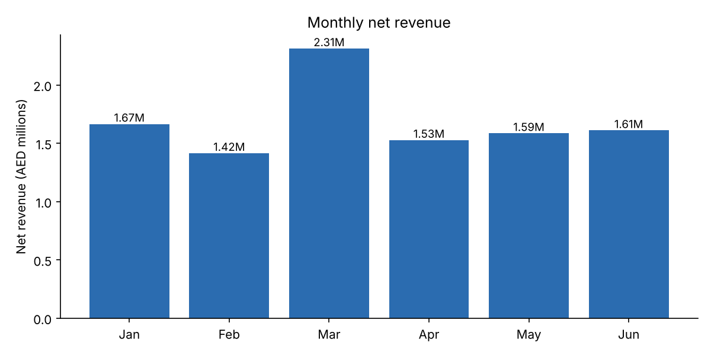

# Retail Sales ETL Pipeline

An end-to-end batch ETL pipeline in Python and SQL. It takes messy monthly point-of-sale CSV exports from a (fictional) UAE electronics retailer, cleans and validates them, and loads them into a SQLite **star schema**. Bad rows are quarantined, every run is logged, and automated data-quality checks run after each load. A SQL analytics layer then produces a business report.

> **Data:** all sales data is **synthetic**, produced by `generate_data.py` with a fixed seed. It deliberately includes the kinds of problems real POS exports have (see below).

## Pipeline

```
data/raw/*.csv ──► Extract ──► Transform ──────────────► Load ──────────► Quality checks ──► report.py
 stores.csv        (as text)    clean / standardise       dim_date         reconciliation     sql/analytics.sql
 products.csv                   validate → reject reason  dim_store        integrity          → reports/
 sales_YYYY_MM.csv              dedupe                    dim_product      sign / outliers
                                derive measures           fact_sales
                                                          quarantine_sales
                                                          etl_run_log
```

| Stage | File | What it does |
|---|---|---|
| Extract | `etl/extract.py` | Reads every `sales_*.csv` as text and tags each row with its source file |
| Transform | `etl/transform.py` | Parses 3 date formats; turns `"AED 1,299.00"` into a number; normalises codes, casing and payment methods; removes exact duplicates; validates each row; derives `net_amount`, `is_return` and `discount_pct` |
| Load | `etl/load.py` | Upserts dimensions and facts in **one transaction**, so a run either fully succeeds or leaves the warehouse untouched. Re-running on the same files is **idempotent** (upsert on `transaction_id`) |
| Quality | `etl/quality.py` | Row-count reconciliation, reject-rate threshold, referential integrity, null measures, return sign consistency, outlier checks |
| Orchestration | `pipeline.py` | Runs the stages, logs each step, records the run in `etl_run_log` (status, counts, checks passed/failed) |

### Data problems handled

| Problem in raw data | Handling |
|---|---|
| Mixed date formats (`2026-03-01 14:05:00`, `01/03/2026 14:05`, `01-Mar-2026 14:05`) | Try each format; unparseable → quarantine |
| Prices as text (`AED 1,299.00`, `1,299.00`) | Strip currency and commas, cast to number |
| `" st01"` vs `ST01`, `" Phone "`, `PHONES` | Trim and normalise case |
| `card` / `CARD ` / `Card` | Map to a standard payment-method list |
| Exact duplicate rows (double exports) | Dropped and counted |
| Re-used transaction ID | Quarantined |
| Unknown product code, missing price, zero quantity | Quarantined with a reason |
| Returns as negative quantity | Kept, flagged `is_return`, negative `net_amount` |

Every raw row is accounted for, and the first quality check confirms it:
`raw rows = loaded + quarantined + duplicates`.

## Star schema

```
 dim_date (date_key, full_date, month, quarter, day_of_week, is_weekend)
     │
     │      dim_store (store_key, store_code, store_name, emirate, channel)
     │          │
     ▼          ▼
 fact_sales (transaction_id, date_key, store_key, product_key, customer_id,
             payment_method, quantity, unit_price, discount_pct, net_amount, is_return)
                ▲
                │
 dim_product (product_key, sku, product_name, category, list_price_aed)
```

## Sample run

```
INFO extracted 10,390 sales rows from 6 files
INFO transform: 10,205 clean, 92 rejected, 93 duplicates
INFO    rejected unknown product            34
INFO    rejected missing or invalid price   33
INFO    rejected invalid timestamp          25
INFO loaded 10,205 fact rows into warehouse.db
INFO    [PASS] row count reconciliation       raw 10390 = loaded 10205 + rejected 92 + duplicates 93
INFO    [PASS] reject rate below 2%           0.89%
INFO    [PASS] referential integrity          0 orphan fact rows
INFO    [PASS] no null measures               0 rows
INFO    [PASS] return sign consistency        0 rows
INFO    [PASS] no extreme quantities/prices   0 rows
INFO run 1 finished: success in 0.3s
```

## Analytics

`sql/analytics.sql` holds named queries that use CTEs and window functions (`LAG` for month-over-month growth, `RANK` for store ranking, `ROW_NUMBER() OVER (PARTITION BY …)` for the top product per category). `report.py` runs them and writes **[reports/sales_report.md](reports/sales_report.md)**.



Highlights from the synthetic data:
- March is the peak month (+63% MoM), reflecting the seasonal promotion built into the generator.
- Online is the single largest store (23% of revenue). Dubai malls together make up 42%.
- Phones and laptops bring in about 63% of revenue. Accessories sell the most units but earn the least.
- Weekend days (Sat–Sun) average about 26% more revenue than weekdays.

## Run it

```bash
pip install -r requirements.txt
python generate_data.py --months 6 --seed 42   # writes data/raw/
python pipeline.py                             # builds warehouse.db
python report.py                               # writes reports/
python -m pytest -q tests
```

## Possible extensions

- Schedule with Airflow or cron and process only new files (file-level watermark)
- Slowly changing dimension (Type 2) for product price history
- Move the warehouse to PostgreSQL or Snowflake. The SQL is mostly portable.
- Power BI or Tableau dashboard on top of `fact_sales`
