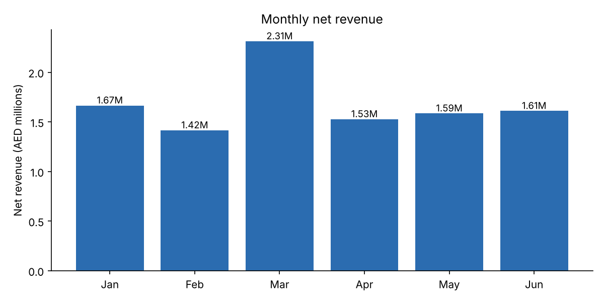

# Sales Report (synthetic data)

Generated from `warehouse.db`. Latest ETL run #1: **success**, 10,390 raw rows → 10,205 loaded, 92 quarantined, 93 duplicates removed; 6/6 quality checks passed.

## Monthly revenue and growth

| year | month_num | month_name | net_revenue | orders | returns | mom_growth_pct |
|---|---|---|---|---|---|---|
| 2026 | 1 | January | 1,665,592.25 | 1653 | 62 | — |
| 2026 | 2 | February | 1,415,258.00 | 1429 | 47 | -15.00 |
| 2026 | 3 | March | 2,312,671.40 | 2189 | 71 | 63.40 |
| 2026 | 4 | April | 1,527,404.45 | 1480 | 39 | -34.00 |
| 2026 | 5 | May | 1,585,643.30 | 1570 | 48 | 3.80 |
| 2026 | 6 | June | 1,610,498.10 | 1572 | 45 | 1.60 |

## Revenue by emirate and channel

| emirate | channel | stores | net_revenue | share_pct |
|---|---|---|---|---|
| Dubai | Mall | 3 | 4,226,716.35 | 41.80 |
| All | Online | 1 | 2,298,193.90 | 22.70 |
| Abu Dhabi | Mall | 2 | 2,185,262.60 | 21.60 |
| Sharjah | Mall | 1 | 965,093.95 | 9.50 |
| Ajman | Street | 1 | 441,800.70 | 4.40 |

## Store ranking

| rank | store_name | emirate | net_revenue | transactions | avg_sale_value | return_rate_pct |
|---|---|---|---|---|---|---|
| 1 | Online | All | 2,298,193.90 | 2223 | 1,092.83 | 2.56 |
| 2 | Dubai Mall | Dubai | 1,964,812.20 | 1855 | 1,127.72 | 3.45 |
| 3 | Yas Mall | Abu Dhabi | 1,493,488.00 | 1468 | 1,068.70 | 2.66 |
| 4 | Mall of the Emirates | Dubai | 1,471,146.00 | 1475 | 1,040.52 | 2.37 |
| 5 | City Centre Sharjah | Sharjah | 965,093.95 | 1048 | 978.55 | 3.72 |
| 6 | Ibn Battuta | Dubai | 790,758.15 | 904 | 951.14 | 2.99 |
| 7 | Al Wahda | Abu Dhabi | 691,774.60 | 730 | 1,023.09 | 3.42 |
| 8 | Ajman High Street | Ajman | 441,800.70 | 502 | 1,007.45 | 5.18 |

## Category performance

| category | units | net_revenue | avg_discount_pct |
|---|---|---|---|
| Phones | 2295 | 3,220,096.05 | 2.70 |
| Laptops | 889 | 3,171,409.35 | 2.60 |
| Audio | 2838 | 1,480,448.70 | 2.70 |
| Wearables | 1073 | 886,683.60 | 2.70 |
| Tablets | 321 | 782,062.05 | 2.40 |
| Accessories | 5569 | 576,367.75 | 2.70 |

## Top product per category

| category | product_name | net_revenue |
|---|---|---|
| Phones | Smartphone X | 1,594,594.95 |
| Laptops | Laptop Air 13 | 1,198,900.20 |
| Tablets | Tablet 11 | 782,062.05 |
| Wearables | Smartwatch | 752,348.10 |
| Audio | Wireless Earbuds | 629,340.85 |
| Accessories | 65W Charger | 184,462.00 |

## Weekend vs weekday

| day_type | days | avg_daily_revenue |
|---|---|---|
| Weekday | 129 | 52,046.11 |
| Weekend (Sat-Sun) | 52 | 65,444.61 |

## Payment mix

| payment_method | transactions | share_pct |
|---|---|---|
| Card | 4276 | 41.90 |
| Cash | 2999 | 29.40 |
| Tabby (BNPL) | 1498 | 14.70 |
| Apple Pay | 1432 | 14.00 |

## Rows quarantined by the pipeline

| reject_reason | rows |
|---|---|
| unknown product | 34 |
| missing or invalid price | 33 |
| invalid timestamp | 25 |
