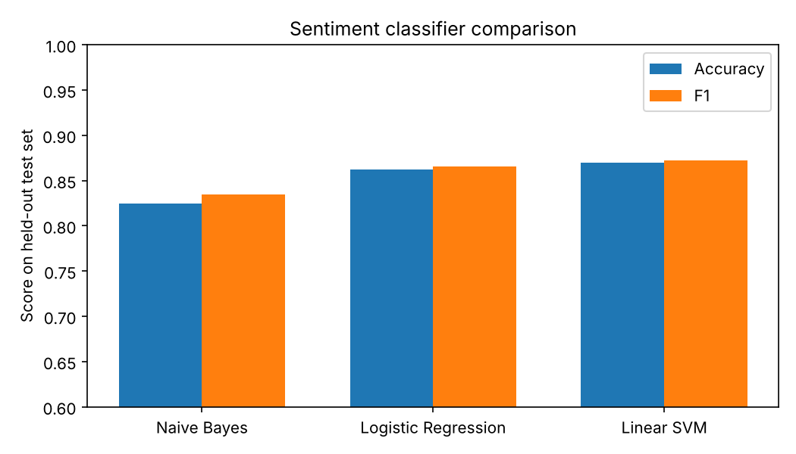
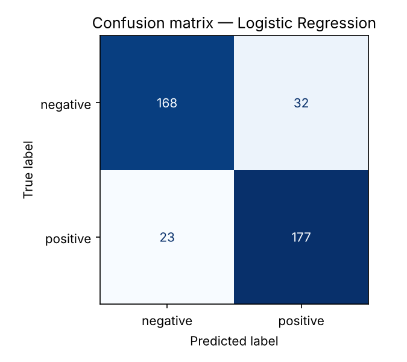

# Sentiment Analysis of Movie Reviews

Binary sentiment classification (positive / negative) of full-length movie reviews using classical NLP: text cleaning, TF-IDF features, and three linear classifiers compared with cross-validation.

## Dataset

[Cornell Movie Review Polarity v2.0](https://www.cs.cornell.edu/people/pabo/movie-review-data/) (Pang & Lee, 2004), which has 2,000 reviews (1,000 positive and 1,000 negative) averaging about 700 words each. `src/data.py` downloads it automatically from the NLTK data mirror on first run, so the raw data is not stored in this repo.

## Approach

1. **Cleaning** (`src/preprocess.py`): lower-casing, HTML/URL removal, contraction handling (`didn't → did not`), stop-word removal. Negation words such as *not*, *no* and *never* are **kept** because they flip meaning.
2. **Features**: TF-IDF on unigrams and bigrams (`min_df=2`, `max_df=0.9`, sub-linear TF). Bigrams let the model see phrases like *not good*.
3. **Models**: Multinomial Naive Bayes, Logistic Regression, Linear SVM (calibrated so it outputs probabilities).
4. **Selection**: 80/20 stratified split. The best model is picked on **5-fold cross-validation on the training set**, and the test set is only used for the final report, which avoids leakage.

## Results

| Model | CV accuracy | Test accuracy | Test F1 |
|---|---|---|---|
| Naive Bayes | 0.851 ± 0.017 | 0.825 | 0.835 |
| **Logistic Regression** (selected) | **0.878 ± 0.024** | **0.863** | **0.866** |
| Linear SVM | 0.876 ± 0.023 | 0.870 | 0.873 |

Logistic Regression and the SVM are within one standard deviation of each other. Logistic Regression was kept because it won on cross-validation and its coefficients are easy to explain.




**Most informative words** (`results/top_features.csv`):
- Negative: *bad, worst, boring, nothing, supposed, script, plot …*
- Positive: *great, perfect, excellent, well, hilarious, overall …*

Words like *supposed* ("was supposed to be funny") and *plot* show up on the negative side because reviewers mention them mostly when complaining.

## Run it

```bash
pip install -r requirements.txt
python src/data.py        # download + dataset summary
python src/train.py       # train, compare, save model and charts
python src/predict.py "The acting was brilliant and the story kept me hooked."
python -m pytest -q tests
```

Example output:

```
POSITIVE  (0.52)  The acting was brilliant and the story kept me hooked.
NEGATIVE  (0.95)  A dull, predictable mess. I wanted my money back.
```

## Limitations and next steps

- The model was trained on **long** reviews, so it is less confident on one-line text (see the 0.52 above). Fine-tuning on short reviews or tweets would help.
- Bag-of-words misses sarcasm and long-range context. A transformer such as DistilBERT would likely reach 90%+, but it costs far more compute.
- Only positive and negative classes. A neutral class would need a labelled 3-way dataset.

## Project structure

```
sentiment-analysis/
├── src/
│   ├── data.py          # download + load dataset
│   ├── preprocess.py    # text cleaning
│   ├── train.py         # model comparison, evaluation, charts
│   └── predict.py       # CLI for new text
├── tests/test_sentiment.py
├── results/             # metrics.json, charts, top_features.csv
└── requirements.txt
```
