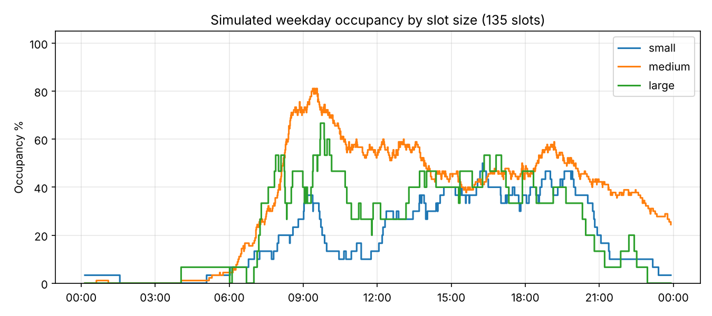

# Smart Parking Management System

A multi-level parking lot manager in Python with SQLite persistence. It assigns the best-fitting free slot to each vehicle, issues tickets, calculates fees on exit, and reports occupancy and revenue. It includes a command-line interface, a one-day traffic simulation, and a pytest suite.

## Features

- **Slot allocation by vehicle type.** Motorcycles need a small slot, cars a medium one and trucks a large one. A vehicle can use a bigger slot if its own size is full.
- **Best-fit strategy.** The system always picks the smallest suitable slot on the lowest level, so large bays stay free for trucks.
- **Ticketing.** Each entry opens a ticket and each exit closes it with a fee. Plates are normalised (`dxb  a 111` → `DXB A 111`) and validated.
- **Data integrity in the database.** Partial unique indexes make it impossible for one plate, or one slot, to have two open tickets, even if the application code has a bug.
- **Pricing** (AED):

  | Vehicle | Per started hour | Daily cap |
  |---|---|---|
  | Motorcycle | 5 | 40 |
  | Car | 10 | 80 |
  | Truck | 20 | 150 |

  The first 15 minutes are free. The cap applies to each 24-hour block.
- **Reports.** Live occupancy by slot size, and revenue / visits / average stay per vehicle type for any date range (SQL aggregation).
- **Testable time.** The clock is injected, so tests and the simulation can move time forward deterministically.

## Architecture

```
parking/
├── models.py    # VehicleType, SlotSize, Slot, Ticket, ParkingError
├── pricing.py   # fee rules (pure function, easy to test)
├── db.py        # SQLite schema + queries (repository layer)
├── lot.py       # ParkingLot service: business rules
└── cli.py       # argparse command-line interface
simulate.py      # one-day traffic simulation + chart
tests/           # 21 pytest cases
```

The layers are kept separate: `pricing` knows nothing about the database, `db` knows nothing about business rules, and `lot` coordinates them. Swapping SQLite for PostgreSQL, or adding a REST API on top of `ParkingLot`, would not touch the pricing or allocation logic.

## Run it

```bash
pip install -r requirements.txt

python -m parking.cli init --levels 3 --small 10 --medium 30 --large 5
python -m parking.cli park "DXB A 12345" car
python -m parking.cli find "DXB A 12345"
python -m parking.cli status
python -m parking.cli leave "DXB A 12345"
python -m parking.cli report --days 7

python simulate.py
python -m pytest -q tests
```

Set `PARKING_DB=/path/to/file.db` to choose where the database is stored (default `parking.db`).

```
$ python -m parking.cli park "DXB A 12345" car
Ticket #1: DXB A 12345 -> slot L1-011 at 16:30
$ python -m parking.cli park "dxb a 12345" car
Error: DXB A 12345 is already parked
$ python -m parking.cli status
size      total  occupied   free
small        30         0     30
medium       90         1     89
large        15         1     14
```

## Simulation

`simulate.py` runs a synthetic weekday through a 135-slot lot. Arrivals peak in the morning and evening, stays are log-normal with a median of about 100 minutes, and the mix is 80% cars, 12% motorcycles and 8% trucks.



```
Completed visits: 419
  car          322 visits  AED  8180.00  avg 2.07 h
  truck         39 visits  AED  1940.00  avg 2.20 h
  motorcycle    58 visits  AED   770.00  avg 2.25 h
Total revenue: AED 10890.00
Peak medium-slot occupancy: 81% at 09:23
```

The 9 AM peak puts car bays above 80%. That is the point where an operator would start routing cars to upper levels or raising peak-hour prices.

## Possible extensions

- REST API (FastAPI) and a small dashboard for the gate operator
- Number-plate recognition at the gate (OpenCV + OCR) feeding `park()` / `leave()`
- Reservations and monthly passes
- Dynamic pricing based on live occupancy
